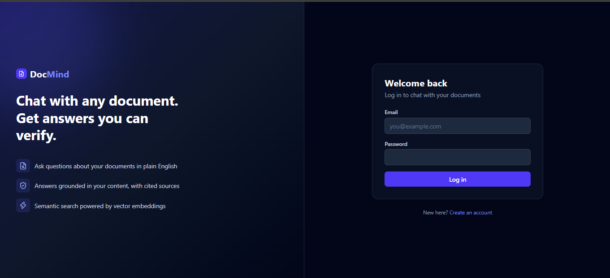
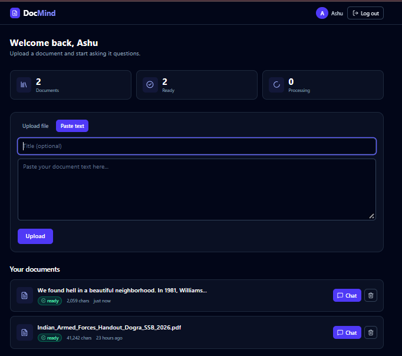
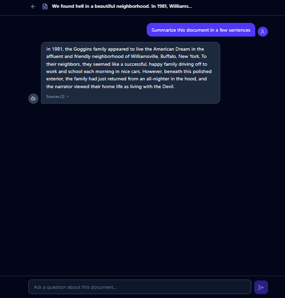
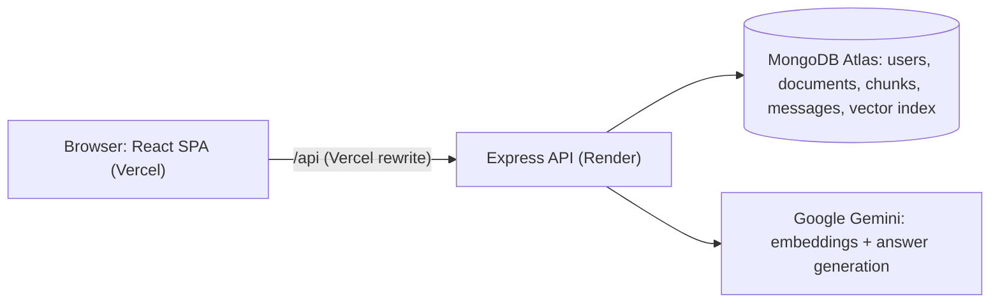

# DocMind

Upload a document, then ask it questions in plain English. DocMind answers **only from your document** and shows which parts it used, so answers can be checked instead of trusted blindly.

**Live demo:** https://docmind-frontend-psi.vercel.app
**Backend repo:** https://github.com/ashutoshraw/docmind-backend

> The backend runs on a free hosting tier, so the very first request after a long idle period can take up to a minute while the server wakes up.





## Features

- **Retrieval-Augmented Generation (RAG):** questions are answered from the uploaded document, and the model is instructed to say so when the answer is not in it, instead of guessing.
- **PDF, text or pasted content:** upload a file or paste text, with an optional title (auto-generated from the first line when left blank).
- **Live processing status:** documents move from `processing` to `ready` (or `failed`) in the background, and the dashboard updates itself without a refresh.
- **Source citations:** every answer can show which document chunks it was based on, with similarity scores for specific questions.
- **Overview questions that actually work:** "summarize this" and "key points" are routed differently from specific questions (see *How it works*).
- **Chat history** is saved per document.
- **Secure sessions:** short-lived access tokens, a refresh token in an httpOnly cookie, and silent session restore on page load.

## Architecture



Vercel forwards `/api/*` to the backend, so the browser only ever talks to one domain. That keeps the refresh cookie first-party, which matters because Safari and most mobile browsers block cross-domain cookies.

## How it works

**1. Ingestion (runs in the background after upload)**

1. The text is extracted (PDF parsing for PDFs) and split into chunks of 1,200 characters with 200 characters of overlap (maximum 150 chunks per document).
2. Each chunk is turned into a 768-dimension vector with `gemini-embedding-2`, in small batches with pauses to respect free-tier rate limits.
3. Chunks and vectors are stored in MongoDB Atlas. The document status flips to `ready`, and the frontend, which polls only while something is processing, picks it up.

**2. Answering a specific question**

1. The question is embedded (with the query-specific task type, which differs from the document one).
2. Atlas Vector Search finds the closest chunks by cosine similarity (50 candidates, top 4 kept), filtered to the current user's document.
3. Gemini receives only those chunks, with instructions to answer from them alone and to say "I couldn't find that in the document" otherwise.

**3. Answering an overview question**

"Summarize this document" contains no topic to match, so vector search would return near-random chunks. These questions are detected and answered from chunks sampled evenly across the whole document instead, so the answer covers the beginning, middle and end.

## Reliability and security

- **Resilient AI calls:** shared retry helper with exponential backoff and jitter on 429/5xx, network failures and timeouts, plus automatic fallback from `gemini-flash-lite-latest` to `gemini-flash-latest`. API keys are sent in headers, never in URLs.
- **Rate limiting** per client IP: 10 requests / 15 min on auth, 10 / min on chat, 300 / 15 min globally. The proxy chain (Vercel, Cloudflare, Render) is accounted for so each user gets their own limit.
- **Safe errors:** unexpected server errors return a generic message to the client and keep details in server logs only.
- **Auth:** JWT access token (15 min) held in memory only, refresh token (7 days) in an httpOnly cookie and stored hashed in the database. Concurrent 401s trigger a single refresh instead of many.
- **Hardening:** helmet, compression, input validation, per-user document isolation.

## Measured results

All numbers are from the live deployment unless noted.

| Metric | Result | How it was measured |
|---|---|---|
| Chat response time | **2.64 s median** (mean 2.64 s, range 1.14-3.39 s) | 15 questions, browser Network tab |
| Answer quality | **15 / 15 handled correctly** | Hand-written test set: 12 in-document questions answered correctly, 3 out-of-scope questions correctly declined |
| Top retrieval similarity | ~0.82-0.87 (cosine) | Observed on specific questions |
| Ingestion speed | 6.3 s for 2,498 characters; 10.0 s for 11,733 characters | Click on Upload until the badge turned green (dashboard polls every 3 s, so real time is slightly lower) |
| Lighthouse (mobile, login page) | Performance 90-91, Accessibility 100, Best Practices 96, SEO 91 | 3 runs, incognito |
| Largest Contentful Paint | 1.8-2.1 s | Lighthouse, same 3 runs |
| Cumulative Layout Shift | 0 | Lighthouse |
| Production bundle | ~122 kB gzipped (116 kB JS, 6 kB CSS) | `npm run build` |

The answer-quality test is small (one document, questions written by the author), so treat it as a sanity check and not a benchmark.

## Tech stack

| Layer | Technology |
|---|---|
| Frontend | React, Vite, React Router, Axios, Tailwind CSS, react-markdown, lucide-react, react-hot-toast |
| Backend | Node.js, Express (ES modules), Mongoose |
| Database | MongoDB Atlas, Atlas Vector Search (cosine, 768 dimensions) |
| AI | Google Gemini (embeddings and generation) |
| Hosting | Vercel (frontend), Render (backend) |

## Run it locally

**Frontend**

```bash
git clone https://github.com/ashutoshraw/docmind-frontend.git
cd docmind-frontend
npm install
```

Create a `.env` file in the project root:

```
VITE_API_URL=http://localhost:5000/api
```

Then start it:

```bash
npm run dev
```

The app opens at http://localhost:5173. You also need the backend running, with `CLIENT_URL=http://localhost:5173` in its environment. Setup steps and required environment variables are in the [backend repo](https://github.com/ashutoshraw/docmind-backend).

## Project structure

```
src/
  api/          Axios client with token refresh, document and chat requests
  components/   Navbar, upload form, document cards, chat bubbles, confirm modal
  context/      Auth provider (session restore, login, signup, logout)
  hooks/        useAuth, useDocuments (loading, errors, adaptive polling)
  pages/        Login, Signup, Dashboard, Chat
  utils/        Error message mapping, history normalization, time formatting
```

## Known limitations and next steps

- No automated test suite yet.
- No password reset flow.
- Answers arrive all at once; streaming the response would make chat feel faster.
- Free-tier hosting means occasional cold starts.

## Author

Built by Ashutosh Singh ([@ashutoshraw](https://github.com/ashutoshraw)).
